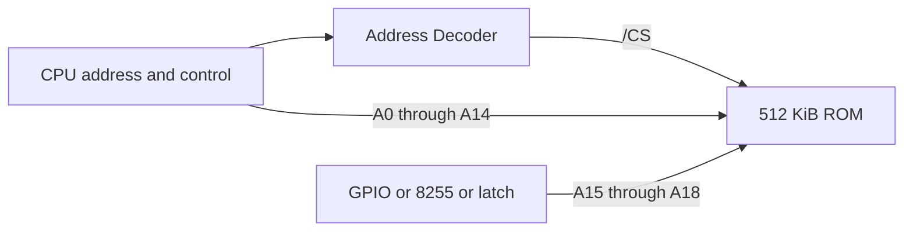

# Memory peripherals and shared bus implementation plan

Status: implemented, 24 November 2026. See [MEMORY_BUS.md](MEMORY_BUS.md) for the
delivered workflow and current limits. The desktop application is `emu51`; the
console runner is `emu51cli`. The design and acceptance matrix below are retained
as the implementation reference. Physical-qualified breakpoint editing remains
optional follow-up work; functional bus strobes do not emit live pin callbacks.

External memory and bus peripherals will become devices in the configured
circuit. Runtime access will follow address, data, control and chip-select
wiring. Program loading will use a separate, explicit mapping from assembled
addresses to physical device storage. This allows banked memory and shared buses
without changing assembly addresses or tying banking to a particular register.

## Agreed scope

- Add RAM, ROM, Clock and Address Decoder blocks to Graph, configured through
  the inspector and activated through the existing title-bar Apply action.
- Give every RAM and ROM continuous physical storage, initialization settings,
  and explicit whole-device and physical-range binary Load and Save operations.
- Support multiple assembly build units and independent editor state in one
  project, with a separate table of output-to-device load mappings.
- Support arbitrary address-line wiring, including permutations and higher
  address bits driven by GPIO, 8255 ports, latches or other port devices.
- Make the decoder a lookup table: a configured number of input bits forms a
  value; each user-created output lists the values that activate it. Validate
  every assignment for collisions.
- Use decoder outputs to select any suitable bus peripheral, including RAM,
  ROM and register-based devices. Chip select is a circuit signal shared by
  this general bus architecture.
- Integrate CPU access, loaders, debugger views, source matching, resets and
  project migration with the same storage and routing model.
- Preserve execution on `Emu51ExecutionWorker`, passive debugger inspection,
  current examples and the compact Live front panel.

The initial model resolves functional bus transactions at transaction boundaries.
Detailed multiplexed 8051 pin timing and oscillator-edge simulation are later
work. There are no mandatory bank-count or bank-select properties on memory,
and no device-plus-bank assembly target. Decoder mask/match rules and expression
languages are superseded by the agreed value-assignment table.

## Architecture and ownership

### Existing integration points

| Area | Current integration point | Planned responsibility |
| --- | --- | --- |
| CPU address spaces | `emu51/core/emu51.h`, `address_space` | Retain CODE/XDATA distinctions and attach the compiled circuit through a host adapter |
| Desktop memory callbacks | `emu51/imgui/emu51_imgui_app.cpp`, `configureAddressSpace` | Replace peripheral interception plus array fallback with consistent circuit access |
| Peripheral bus | `emu51/peripherals/emu51_peripheral_bus.*` | Resolve functional address/data/control transactions and provide explicit inspection access |
| Active circuit | `emu51/peripherals/emu51_peripheral_session.*` | Own compiled routing, device state, physical storage references and worker snapshots |
| Configuration | `emu51/peripherals/emu51_peripheral_config.*` | Describe devices, pins, wiring, decoder assignments and validation |
| Project persistence | `emu51/io/emu51_project.*` | Store build units, load rows, memory initialization, Clock and circuit configuration |
| Graph and inspector | `emu51/imgui/emu51_peripheral_editor.*` | Edit drafts, show validation, and retain the existing Apply workflow |
| CPU pacing | `emu51/imgui/emu51_cycle_timing.h` and execution worker | Derive oscillator rate from the connected Clock and preserve independent execution |

Other debugger and loader helpers currently access `unifiedMemory_`,
`ramMemory_` and `romMemory_` directly. Inventory and convert those callers;
changing only CPU callbacks would leave inconsistent views and programming.

### License and runtime boundaries

Physical memory models, the decoder model, general electrical resolution and
reusable bus-device contracts belong in the independently LGPL-2.1-only SDK.
The 8051 adapter, project loader, assembler integration and desktop UI remain
GPL application code. Keep the core usable with simple address-space hosts for
standalone CPU tests and tools.

Device libraries remain statically linked. This work does not add shared-library
loading or runtime plugin discovery. Extend the existing SDK interfaces in a
versioned, compatible way; retain installed C consumer and SDK package checks.

The simulation worker owns mutable runtime state. Graph edits remain UI-owned
drafts. UI rendering consumes snapshots and never performs live bus transactions.
Native audio callbacks retain their existing isolation from CPU, SDK and UI work.

## Physical RAM and ROM

### Device configuration

Each memory device has a stable ID, a display name, RAM or ROM type, physical
capacity in bytes, initialization settings and named pins. Names can change
without changing IDs, wiring endpoints or load mappings.

Physical storage is one continuous byte array. Address pins are `A0` through the
highest bit needed for the capacity; `A0` is the least significant bit. Capacity
need not be a power of two: an address outside the allocated bytes is invalid,
even if representable by the pins. Use checked physical offsets and lengths
that can represent devices larger than the CPU's 64 KiB logical address space.

Both devices expose an 8-bit data bus and chip-select/output-enable inputs. RAM
also exposes write enable. Control polarity is configurable and visible in the
inspector and pin labels; active-low signals are presented as `/CS`, `/OE` and
`/WE` by default.

CPU internal RAM and SFRs remain part of the CPU model. These new RAM and ROM
chips provide external storage.

### Access contracts

Keep three distinct operations:

| Operation | Address | Behavior |
| --- | --- | --- |
| CPU or device bus access | Current wired address and controls | Obeys selection, enable signals, electrical state and RAM/ROM behavior |
| Explicit programming | Device ID and physical offset | Loads bytes directly into RAM or ROM without changing selector pins or requiring the device to be selected |
| Passive inspection | CPU logical address or device physical offset | Returns a value and resolution status without advancing time or causing device side effects |

CPU writes never modify ROM. Explicit image loading, assembly programming and
deliberate debugger programming may modify ROM through the programming API.
Internal loading must not use ordinary CPU bus writes as a shortcut.

One physical RAM can be exposed in both CODE and XDATA. All aliases share the
same bytes and storage revision; writes through one alias are visible through
the others.

### Initialization

Construct power-on contents in this order:

1. Apply the configured fill.
2. Apply configured binary initialization images at physical offsets.
3. Apply assembly and other program load rows in their defined order.

New-device defaults should be deterministic: propose `00h` for RAM and `FFh`
for ROM. Migration preserves old fill behavior explicitly. Initialization
images can cover a complete chip or a validated physical range.

Editing initialization settings changes the power-on recipe. Applying that
recipe to existing storage is an explicit power-cycle/reinitialization action;
it must not happen merely because unrelated wiring or Clock settings change.

### Binary Load and Save

Every RAM and ROM inspector offers whole-device and selected physical
offset/length operations. Display capacity and the selected physical interval
before execution. A bank/range export is a view of storage; it never changes
the active selector or temporarily switches banks.

For the initial implementation, whole-device Load requires a file whose length
equals capacity. A selected-range Load requires a file whose length equals
the chosen range. Users can load a smaller image by explicitly choosing its
destination offset and length. Reject truncation, silent padding, overflow and
out-of-range operations before modifying bytes.

Read and validate an entire input before committing a Load. For Save, copy a
consistent snapshot under the execution lock, then release the lock before
writing the file. Use the existing safe file-replacement facilities so a failed
write preserves an existing destination file. Report file errors in the UI.

A manual Load changes runtime contents. Retaining a file as an initialization
source is an explicit inspector setting. Save Project stores configuration,
references and source drafts; it does not implicitly overwrite binary images
or save every chip's live bytes. Store file paths relative to the project where
possible.

## Shared CPU and peripheral bus

### Functional bus connections

Expose a functional CPU address bus, 8-bit data bus and distinct CODE read,
XDATA read and XDATA write control signals. Document the active levels and
their relationship to `/PSEN`, `/RD` and `/WR`. CODE fetches, CODE table reads
and XDATA operations retain their current instruction semantics.

These are functional transaction connections. The first implementation does
not require users to reconstruct multiplexed P0/ALE timing. Keep that distinction
clear in documentation and leave room for a later pin-timed frontend.

Bus-capable devices expose their own address or register-select inputs, data
pins, chip select and the read/write controls they support. The decoder's output
can select memory, an 8255 or any other suitable bus peripheral. The selected
device interprets its local address pins; the decoder does not know its type.

Serial peripherals retain their actual serial interfaces. They join a parallel
CPU bus only through an appropriate bridge/controller, rather than acquiring
an artificial register interface automatically.

### Transaction sequence

Compile the circuit when applying a valid configuration. A runtime transaction
then performs these operations on the worker:

1. Form the CPU address, access kind and control levels. For writes, drive the
   data byte; for reads, release the CPU data drivers.
2. Resolve the relevant address, control and selector nets using current GPIO,
   latch and peripheral state. Evaluate combinational decoder outputs.
3. Determine selected devices, local physical/register addresses and enabled
   data drivers. Validate controls, bounds and electrical state.
4. Resolve the read byte or deliver the write byte. Commit each selected
   device's permitted transaction side effects exactly once.
5. Release transaction-specific drives and publish diagnostics/snapshots as
   needed. Advance time through the existing CPU/SDK timing path.

Separate preparation from side-effect commitment so a failed bus resolution
does not consume a FIFO item or partially program memory. Multiple write
receivers can intentionally accept the same bus byte; multiple incompatible
data drivers must be diagnosed.

GPIO or latch changes affect the next applicable access without a CPU reset,
storage reconstruction or UI callback. Resolve sequential changes in a defined
order. Reject unsupported purely combinational feedback at Apply; feedback
through modeled latches/registers is valid.

### Electrical state and faults

Honor floating, high-impedance, weak pull-up, open-drain and contended signals
through the SDK's electrical model. Preserve the existing P0 pull-up rules.
Unselected devices and devices with disabled outputs release their data pins.
An undefined address/control bit is not silently interpreted as zero.

Distinguish ordinary unmapped access from a circuit fault. Proposed default:
unmapped reads return the documented open-bus value `FFh`, and unmapped writes
have no recipient. Invalid controls, relevant unresolved nets, conflicting
drivers and selected out-of-range addresses produce a diagnostic with the
access space, logical address, device and affected pins. Suppress invalid
transaction side effects and pause execution at an instruction boundary.
Do not promise rollback of CPU work already performed within that instruction.

### Compiled routing and performance

Precompute endpoint IDs, bus bit mappings, decoder lookup structures and
combinational dependencies at Apply. Resolve only affected nets per access;
avoid reparsing names or rebuilding the graph in the hot path.

Use an efficient lookup representation without requiring an allocation of
`2^N` entries for every decoder. Keep execution independent of display refresh
and avoid a UI event/callback for every bus transition. UI bus diagnostics can
sample the latest worker state rather than recording every transaction.

## Address Decoder

### Input value and outputs

The user configures the number of digital input bits, `N`. Together, inputs
`I0` through `I(N-1)` form an unsigned value from `0` to `2^N - 1`; `I0` is the
least significant bit. The inspector documents the supported width limit.
Any compatible circuit signal can drive each input, including CPU address
bits, control signals, GPIO, 8255 ports and latch outputs.

The user adds named output lines with stable IDs. Each output has an explicit
list of input values that activate it. Output polarity is configurable, with
active-low `/CS` outputs as the default. All output lists share one decoder
input-value namespace.

For four input bits:

| Output | Activating input values |
| --- | --- |
| `/CS_ROM` | `0h`, `1h`, `2h`, `3h` |
| `/CS_RAM` | `4h`, `5h`, `6h`, `7h` |
| `/CS_IO` | `Ch`, `Dh` |

An assigned value activates its output and deactivates the others. An
unassigned value leaves every output inactive. Relevant unresolved or
contended inputs produce an unresolved decoding result and circuit diagnostic;
they must not select an arbitrary output.

### Inspector workflow and collision validation

The inspector provides input width, named outputs, per-output polarity,
editable value lists, Add output, Add value and removal controls. Accept clear
hexadecimal and decimal input and show each value's bit representation.

Validate every assignment as it is edited:

- Reject values already assigned to another output. Identify the value and
  conflicting output in the error.
- Reject duplicate entries within one output.
- Reject malformed, negative or out-of-range values.
- When input width decreases, flag every existing value that no longer fits.
  Never mask, wrap or silently discard assignments.
- Preserve existing assignments when outputs are renamed or reordered.
  Removing an output removes its assignments explicitly from the draft.

Keep invalid edits in the draft for correction and disable Apply while errors
remain. Run the same validation for SDK construction and project loading;
UI validation alone is insufficient. Empty output lists can exist while
editing and simply never activate.

Collision validation is strict within each decoder. Separate decoders and
user wiring can still select competing devices, so runtime bus resolution
must independently detect competing drivers. Decoder assignments do not
guarantee that the entire circuit has only one active data source.

### Example of bus selection

Connect CPU `A13`, `A14`, `A15` to decoder `I0`, `I1`, `I2`. Each value then
identifies an 8 KiB CPU region. Assign `0` to `/CS_BOOT`, `1,2,3` to `/CS_RAM`
and `4,5,6,7` to `/CS_PROGRAM`. Connect those outputs to the corresponding
devices. Connect each device's remaining local address and read/write inputs
separately. A bus peripheral's register-select pins may use only `A0` and `A1`;
that can create register aliases within its selected region, as dictated by
the wiring.

The decoder performs the same lookup regardless of whether its outputs select
RAM, ROM, an 8255 or another bus device. To distinguish CODE from XDATA or
qualify access with another signal, wire the appropriate control signal into
an input bit and assign the resulting values explicitly.

## Banking through address wiring

A 512 KiB ROM exposed through a 32 KiB CPU window can use:

- ROM `A0` through `A14` connected to CPU `A0` through `A14`.
- ROM `A15` through `A18` connected to four GPIO, 8255 or latch output bits.
- ROM `/CS` connected to a decoder output selecting the CPU window.
- ROM `/OE` connected to the appropriate read control.



The high address inputs select physical storage directly. Changing them
changes the bytes visible to subsequent CPU accesses without losing memory.
Address-bit permutations, grouped wires and partial address decoding are
supported by the same mechanism.

An optional memory-mapped selector register may emit convenient output bits.
It is an ordinary bus device and is not required for banking. A single device
may appear in several logical windows or address spaces, and multiple logical
addresses can refer to one physical byte.

## Assembly build units and program loading

### Project tree and editors

Represent each assembly build unit with a stable ID, project-relative source
path or embedded source, include settings and independent build results.
Maintain separate editor text, dirty/save baseline, draft recovery, cursor,
undo/redo state, diagnostics, listing and symbol information for each unit.

The project tree distinguishes build units from include files. Sharing an
include file does not automatically make it a separate output. Identical
symbol names in different units remain distinguishable by unit identity.
Opening, switching, closing and recovering files must preserve their state.
Save Project follows the existing draft/reference semantics without silently
overwriting referenced assembly files.

### Explicit load mapping table

Each row records a source unit, source address interval, target memory device
ID, destination physical offset, order and explicit overlay policy. Display
source intervals inclusively in the UI; use checked interval arithmetic that
can represent an exclusive end at `10000h` internally.

| Assembly file | Source addresses | Target device | Destination offset |
| --- | --- | --- | --- |
| `monitor.asm` | `0000h–1FFFh` | `boot_rom` | `00000h` |
| `application.asm` | `8000h–FFFFh` | `program_rom` | `10000h` |
| `tables.asm` | `4000h–47FFh` | `work_ram` | `02000h` |

Copy each emitted byte using:

```text
chip offset = destination offset + (assembly address - source range start)
```

`ORG` continues to mean an address in the assembler's logical address space.
Choosing a target never changes `ORG`, instruction encoding, symbols or branch
targets. Whether the resulting bytes execute at those logical addresses
depends on the active circuit wiring.

One unit can have several rows to split its output across chips. Several units
can populate one chip. Require all emitted bytes intended for loading to be
accounted for; report unmapped emitted bytes rather than silently discarding
them. Any build-only output must be identified explicitly.

Preserve sparse segments. Copy only emitted bytes inside each source interval;
gaps neither consume packed output positions nor clear destination storage.
Do not reduce a sparse addressed image to a contiguous binary blob for this
operation.

### Validation and programming transaction

Validate unit IDs, file/include availability, source intervals, device IDs,
destination ranges, capacity and integer overflow. Compute the physical bytes
each row would write. Reject destination byte collisions unless the affected
rows explicitly opt into ordered overlays. Sparse gaps do not themselves
write bytes; rebuilds must recheck collisions when emitted segments change.
Show potentially intersecting destination windows in the mapping view.

Give every row a stable explicit order. Ordered overlays use that order, with
later bytes replacing earlier ones. The initialization stages retain their
documented fill, binary-image, program precedence; collisions among program
rows are never authorized merely by that stage ordering.

Build and validate all required units and inputs before programming any target.
Prepare a complete write set, then commit it under the execution lock. Failed
assembly or mapping leaves active memory and CPU state intact, while diagnostics
can update. Programming an inactive physical region does not change selector
ports or require temporarily exposing that region in the CPU map.

Define Build, Build and load, Reload and Power cycle around these operations.
Retain explicit targets for standalone HEX and BIN input as well; BIN has a
declared source base address rather than an inferred chip placement. Project
loading validates the entire required build before replacing the active machine.

## Clock configuration

Add a Clock block with a named output connected to a CPU clock input. Its
inspector sets oscillator frequency with validation and clear Hz/MHz units.
Require one valid supported clock source for an executing CPU and diagnose
missing or competing sources.

The connected Clock becomes the authoritative oscillator frequency. Existing
`crystalMHz_`-based pacing, SDK tick rate, peripheral deadlines and audio timing
derive from it. Preserve the classic model's 12 oscillator ticks per machine
cycle and the existing integer-remainder handling that avoids pacing drift.
Clock configuration must not create an independent second frequency setting.

Frequency edits go through Apply, which resets and pauses execution while
preserving unchanged external storage. Rebase worker pacing and audio timelines
consistently. The initial Clock communicates frequency to the timing system;
it does not require an SDK/UI callback on every oscillator edge. Existing
instruction-budget execution mode remains available, with simulated device time
still derived consistently from the configured oscillator.

## Graph and inspector integration

Add RAM, ROM, Clock and Address Decoder to the existing Graph Add menu. Show
numbered pins and grouped bus connections, with bit mapping and polarity visible
in the inspector. Validate device parameters, pin compatibility, net widths,
decoder assignments, controls and supported combinational dependencies.

Use the existing title-bar Apply path. Construct and validate a replacement
session before changing the active one. A failure retains the running machine,
CPU state, current memory and editor drafts. A successful Apply resets/pauses
execution and transfers unchanged memory storage into the replacement session.
Do not add a second activation path inside these device inspectors.

RAM, ROM, Clock, decoder blocks, CPU blocks and bare ICs remain Graph/inspector
configuration. They do not become Live boxes. Live continues to show displays,
LEDs, switches, buttons and keypads, with the established audio and adjustable
source exceptions. Preserve resizing, keypad Toggle/While pressed modes and
project layout persistence.

Honor native macOS menu ownership and shortcut routing, with ImGui shortcuts
on Linux/Windows. Keep paused redraws responsive during graph wiring, scrolling,
dragging, value-list editing and inspector interactions.

## Debugger and source identity

### Logical and physical views

Provide CPU CODE/XDATA views and direct device/physical-offset views. Physical
views can inspect bytes outside the currently selected CPU window. Display
the resolved device and physical offset for logical addresses where available.
Make fill, clear, manual edits, binary operations and watchpoint behavior use
these explicit views and the appropriate storage/programming contracts.

Maintain logical-address breakpoints. Add qualified physical breakpoints and
watchpoints where practical, keyed by device ID and physical offset rather
than a device-specific bank number. Preserve separate internal RAM/SFR views.

### Passive inspection

Debugger peeks evaluate routing from a snapshot of current selectors and virtual
access controls. They do not toggle live bus pins, advance SDK time, acknowledge
interrupts, consume queues or invoke ordinary side-effecting peripheral reads.
For a peripheral that cannot provide a passive value, return an explicit
unavailable status instead of falling back to a live read.

Memory panes, disassembly, watches, source matching and tooltips all use this
inspection path. A bank change must be visible without needing a CPU reset or
an unrelated UI action.

### Sources and caches

Associate loaded source bytes with unit ID, build revision, source address,
load row, target device ID and physical offset. Resolve the currently visible
instruction to that physical identity before choosing a source line or symbol.
Do not display a source match from another physical region just because its
logical address is the same.

Invalidate disassembly/source caches when routing or relevant storage revisions
change, including writes through aliases and explicit programming. Where live
bytes no longer match a loaded build, show disassembly without a misleading
source association. Key shared-memory changes by physical storage identity.

## Reset and session lifecycle

| Action | CPU and execution | External memory |
| --- | --- | --- |
| CPU Reset | Reset CPU registers and ports; retain the existing reset/stop shortcut distinction | Preserve bytes |
| Power cycle | Recreate the machine and reset execution | Reconstruct from fills, binary initialization images, then ordered program rows |
| Apply wiring or Clock edits | Validate a candidate, reset and pause | Preserve devices with unchanged ID, memory type and capacity |
| Apply memory removal, type or capacity change | Validate and show which storage will be replaced before Apply | Recreate affected storage from its initialization recipe |
| Load binary or program output | Use an explicit programming transaction and the action's stated reset behavior | Change only validated target bytes |
| Save binary | Capture a consistent snapshot, then write outside the lock | Preserve all bytes and selectors |
| Save Project | Persist configuration, source state and references | Do not implicitly save live chip bytes to image files |

Resetting CPU ports can select a different physical region even though all
memory bytes survive. Device reset behavior follows modeled reset inputs and
the defined reset action; avoid accidentally reconstructing memory through a
generic peripheral reset helper.

Retain storage by stable identity during candidate construction. Never transfer
mutable ownership to an invalid candidate or mutate the active session while
loading its replacement. Native audio activation remains an explicit lifecycle
step, and failures preserve the usable existing machine.

## Project format and migration

Extend the existing project format with versioned records for memory parameters
and initialization images, Clock, decoder input/output assignments, functional
bus wiring, assembly units, per-unit editor state and ordered programming rows.
Use stable IDs for references and project-relative paths where possible.
Keep graph presentation and Live layout separate from circuit configuration.

Migrate existing projects transactionally:

1. Translate unified memory to one compatible external storage device shared
   by CODE/XDATA; translate split memory to separate CODE and XDATA storage.
2. Preserve the previous CODE write behavior where compatibility requires RAM
   semantics; do not blindly convert all old program backing to protected ROM.
3. Preserve peripheral MMIO priority when translating fallback memory. Generate
   decoder assignments/wiring that leave claimed peripheral accesses with the
   peripheral and retain memory for the remaining addresses.
4. Convert old crystal frequency into a Clock and its CPU connection.
5. Convert the existing editor and program recipes into build units and explicit
   physical programming rows, preserving logical source addresses and BIN bases.
6. Preserve peripheral configuration, layouts, UART settings, breakpoints,
   watches, embedded drafts and project-relative include behavior.

Do not invent ambiguous overlaps during translation. If a configuration cannot
be translated unambiguously, explain the conflicting route and leave the active
machine intact. Save migrated projects in the new format only through an
explicit project save. Old examples and default launches must continue to work.

Default constructors for `emu51`, `emu51cli`, tests and benchmarks need compatible
machine factories or simple host adapters. Keep CPU-only tests independent of
the desktop graph. Update explicit local-extension integration without importing
board-specific assets into public code.

## Implementation phases

### Phase 1 Physical storage and programming

Implement SDK RAM/ROM storage, checked physical ranges, distinct bus/programming
access, initialization recipes, revisions and consistent snapshots. Add host
binary I/O outside the execution lock. Establish storage identity transfer for
future Apply without changing existing user-visible routing yet.

Completion: binary round trips and programming are correct for complete devices,
partial ranges, capacities beyond 64 KiB, ROM protection and failure atomicity.

### Phase 2 Bus interfaces and lookup decoder

Define functional CPU and bus-device pin contracts. Implement the generic
decoder, stable output IDs, value-assignment validation and efficient lookup.
Extend graph configuration, pin descriptions and inspector drafts. Introduce
versioned project records alongside compatibility readers.

Completion: a configured decoder selects memory and a non-memory bus device
from the same lookup model; duplicate/out-of-range assignments fail consistently
in UI, SDK construction and project parsing.

### Phase 3 Circuit transaction routing

Compile wiring and resolve CODE/XDATA accesses through addresses, controls,
GPIO selectors and chip selects. Add adapters for currently memory-mapped
peripherals, side-effect commitment and explicit bus faults. Retain a controlled
compatibility path until existing MMIO and fallback memory can migrate safely.

Completion: bank changes, address permutations, register selection, aliases and
shared CODE/XDATA storage work on the worker with no UI involvement. Invalid
transactions do not partially change selected devices.

### Phase 4 Assembly project tree and load mappings

Add multiple build units, independent editors/build results and the mapping
table. Plan all writes before programming. Support split outputs, combined chip
contents, sparse images, explicit overlays and standalone HEX/BIN recipes.
Integrate Build, Load and Reload with transactional project/session loading.

Completion: `ORG` and encoded instructions remain unchanged; programs can be
loaded into inactive physical regions without touching selector state.

### Phase 5 Clock and complete inspector workflows

Connect the Clock to CPU pacing and SDK timing, and finish RAM/ROM binary actions,
initialization controls and decoder editing. Preserve storage for unrelated
Apply changes. Keep all new configuration blocks out of Live.

Completion: a graph-configured Clock controls timing, binary files are handled
safely, validation blocks bad Apply operations and paused interactions remain
responsive across supported platforms.

### Phase 6 Debugger lifecycle and migration

Replace remaining desktop array shortcuts with storage/routing access. Add
logical and physical views, passive peeks, physical source identity and cache
invalidation. Finish reset/power-cycle semantics, legacy project translation,
default factories and local-extension compatibility.

Completion: debugger results follow selected physical memory, inspection has
no runtime side effects, reset preserves external bytes and failed migration
or project loading preserves the active machine.

### Phase 7 Examples regression and release integration

Add generic examples for banked ROM, shared CODE/XDATA RAM, decoder-selected
RAM plus an 8255, multiple assembly units and inactive-region programming.
Document inspector workflows, formats, migration and functional timing limits.
Run standard and optional local-extension checks, SDK consumer checks and
installed/relocated package verification with the renamed executables.

Completion: the acceptance matrix below passes, existing examples retain their
behavior and public exports/packages contain only redistributable material.

## Acceptance tests

| Area | Required coverage |
| --- | --- |
| Storage and binaries | RAM/ROM full and range round trips; offsets above 64 KiB; exact lengths; capacity boundaries; overflow; short/failed reads and writes; unchanged state after failure |
| ROM and programming | CPU writes preserve ROM; explicit programming changes it; inactive-region loading preserves selector ports |
| Decoder | Every valid key, multiple keys per output, unassigned values, mixed numeric entry, duplicates within/across outputs, width changes, stable IDs and project round trips |
| Decoder independence | The same decoder selects RAM, ROM and a register peripheral; controls/GPIO can form input bits; separate decoders can still produce diagnosed contention |
| Address wiring | Straight, grouped and permuted bits; GPIO/8255/latch high bits; partial decoding and aliases; physical addresses outside capacity |
| Electrical state | Chip-select/output/write polarity; unselected high impedance; floating and contended address/data/control nets; weak pull-ups and P0; invalid control combinations |
| Bus transactions | CODE fetch/table read versus XDATA read/write; local register pins; bus turnaround; exactly-once peripheral side effects; invalid writes do not partially commit |
| Shared memory | One RAM in CODE and XDATA; writes through aliases; coherent snapshots, watchpoints and cache invalidation |
| Assembly mappings | `ORG` preservation; source intervals; split output; multiple units per chip; sparse gaps; unmapped bytes; actual-byte collisions; explicit overlay order |
| Multiple editors | Independent buffers, diagnostics, listings, symbols, undo/redo, dirty baselines, recovery, includes and failed saves |
| Project transactions | All required inputs validated before replacement; missing files, bad assembly, invalid wiring or mappings preserve the current machine |
| Reset and Apply | CPU reset preserves external bytes; ports may change the selected region; power cycle replays recipes; Clock/wiring Apply preserves unchanged storage |
| Clock and execution | Frequency validation, absent/competing clocks, cycle conversion, fractional-rate pacing, audio rebase and execution independent of UI refresh |
| Passive debugger | Repeated peeks do not change pins, ticks, FIFO contents, interrupts or device state; unsupported inspection is explicit |
| Source and disassembly | Switching selectors chooses the correct physical source; self-modification/programming removes stale matches; logical breakpoints remain useful |
| Migration | Split/unified projects, writable legacy CODE storage, MMIO exclusions/priority, old crystal frequency, old load recipes, layouts and bundled examples |
| UI and platform behavior | Title-bar Apply, draft validation, decoder editing, graph bit wiring, memory ranges, paused redraws, native macOS shortcuts and Linux/Windows ImGui shortcuts |
| SDK and distribution | C ABI/consumer compatibility, LGPL/GPL boundaries, static libraries, explicit install resources, renamed executables and relocated packages |

## Source and delivery workflow

Follow [CONTRIBUTING.md](CONTRIBUTING.md) for source ownership and validation,
and [RELEASE.md](RELEASE.md) for packaging. From the public source root, configure
with `cmake -S . -B build`, build all required targets and run the appropriate
CTest checks. Retain `emu51` and `emu51cli` as the desktop and console names.

When working from a containing development repository, follow its source/export
instructions before updating the independent public checkout. Preserve retained
reference files, their bytes, include relationships and history. Proprietary
board firmware and music stay outside public exports, source archives and release
packages. Use generic public examples and explicit installation resource lists.
